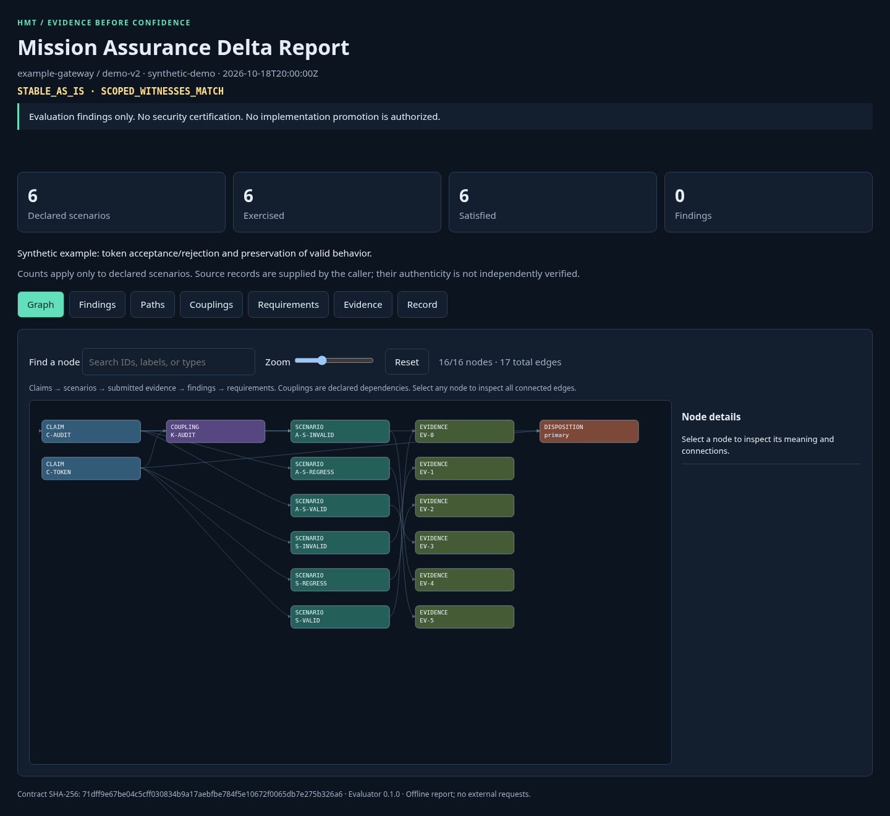
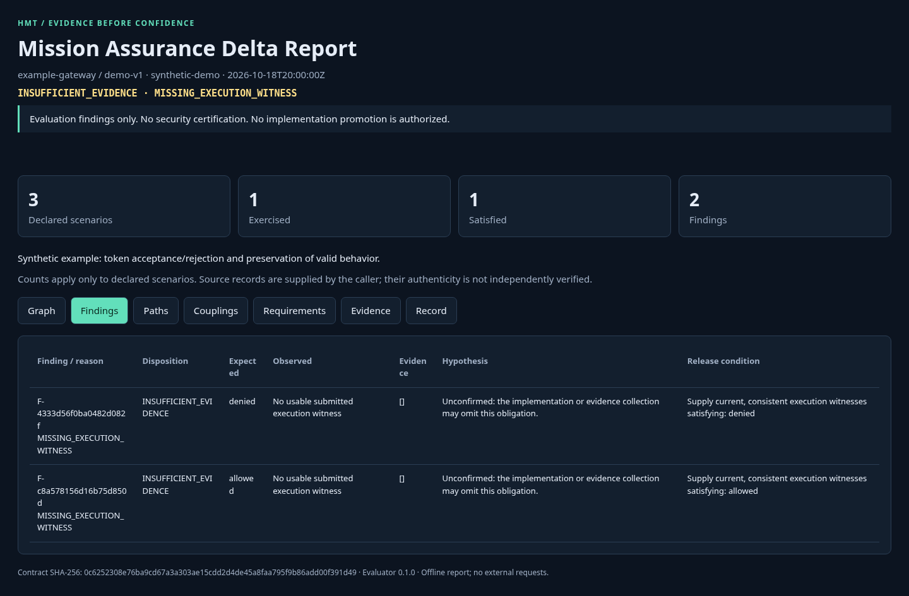
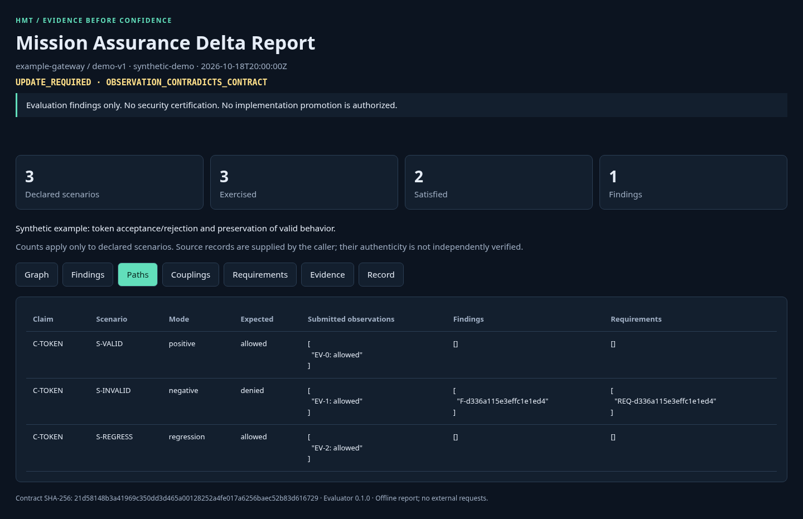
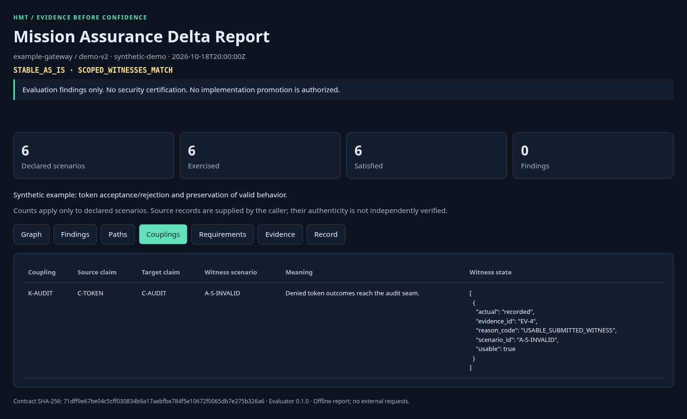
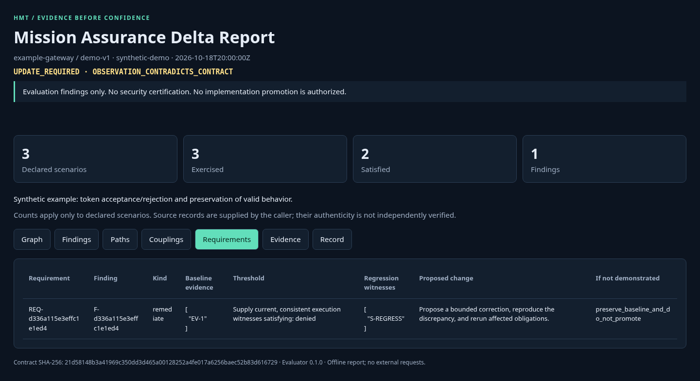
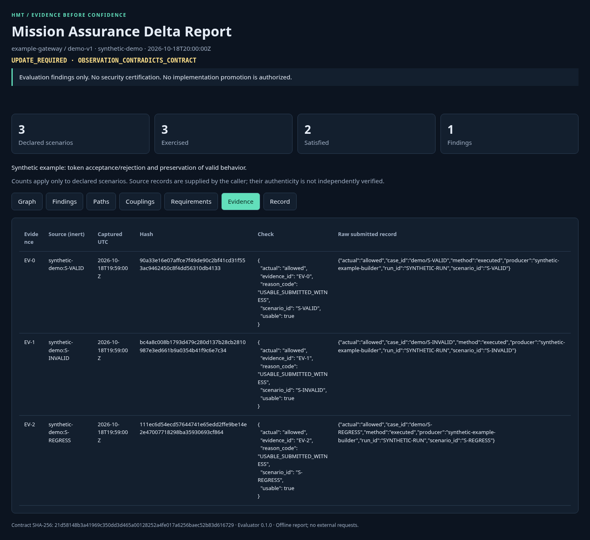
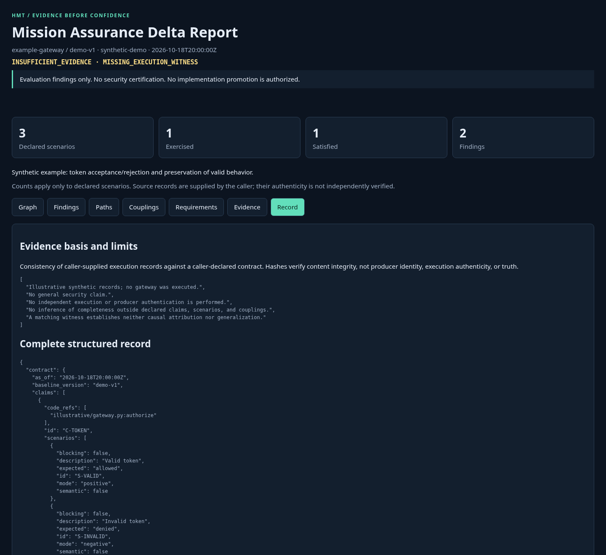

# HMT Mission Assurance

[](https://github.com/CollaborativeMinD/HMT-Mission-Assurance/actions/workflows/verify.yml)
[](pyproject.toml)
[](LICENSE)
[](#connect-mcp)

**Turn engineering claims and supplied execution records into a scoped, traceable assessment.**

HMT Mission Assurance helps an agent determine what the available evidence supports, what remains unknown, and what must be demonstrated next. It separates observed failures from untested claims and derives requirements with measurable acceptance thresholds and regression obligations.

One agent skill. Four read-only MCP tools. A CLI that produces JSON, Markdown, and an interactive offline HTML report from the same typed evaluation contract.

[Get started](#install) · [See the report](#report-views) · [Understand the bounds](#scope-and-bounds) · [Operator runbook](Runbook.md)

## Purpose

Use it for baseline reviews, change proposals, and engineering claims that need a clear evidence trail. Supply a specific claim, the baseline and environment it concerns, expected positive/negative/regression behavior, and selected existing execution records. Receive one primary disposition, all supporting findings, and requirements tied to the contract and evidence.

The agent gathers evidence through its authorized host tools; the evaluator checks the supplied contract. Missing witnesses remain unknown. A matching result applies only to the declared scenarios. Findings never authorize deployment or certify security.

## Install

Requires Python 3.12+ and [uv](https://docs.astral.sh/uv/getting-started/installation/).

```bash
uv tool install 'git+https://github.com/CollaborativeMinD/HMT-Mission-Assurance.git'
hmt-mission-assurance --version
hmt-mission-assurance install-skill
```

If your shell cannot find the installed command, run `uv tool update-shell`, then open a new shell. MCP hosts can use the executable's absolute path.

The skill installer creates `hmt-mission-assurance/SKILL.md` beneath `$CODEX_HOME/skills` (or `~/.codex/skills`). It refuses to replace an existing skill. For another skill-compatible agent, select its skill directory explicitly:

```bash
hmt-mission-assurance install-skill --dest /path/to/your/agent/skills
```

The Git URL is the supported installation path; a package-index release is not required. Use `uv tool install hmt-mission-assurance` only after a registry release exists. For reproducible installs, pin a reviewed commit with `git+https://github.com/CollaborativeMinD/HMT-Mission-Assurance.git@COMMIT_SHA`.

## Point an agent at a project

Invoke `$hmt-mission-assurance` and provide a project path plus a specific claim and baseline. The agent reads authorized project artifacts using its host tools, selects existing execution witnesses, and constructs the contract. The evaluator does not autonomously crawl or execute a project. Missing witnesses are a useful finding.

> Use $hmt-mission-assurance on /work/gateway at commit abc123. Assess whether expired tokens are rejected without weakening valid-token behavior. Derive requirements for anything the evidence cannot establish. Save the delta report.

For an immediate CLI demonstration:

```bash
hmt-mission-assurance example > contract.json
hmt-mission-assurance evaluate contract.json --out first-report
# Exit 2 is expected: the starter intentionally lacks failure-mode witnesses.
```

Open `first-report/delta-report.html`, or read `delta-report.md` and `evaluation.json` in the same directory. Exit `0` means the supplied scoped evidence matches, `2` means the evaluation has findings, and `3` means invalid input or destination. The starter's exit `2` is expected.

## Report views

The HTML report is self-contained and makes no external requests. Search the graph, adjust zoom, and select a node to inspect its connections. Seven tabs connect the assessment to its evidence and required next steps.

The screenshots below are real Chromium captures of the bundled **synthetic examples**. They demonstrate the interface and submitted-record consistency; no gateway was executed.

**Graph — follow claims, scenarios, evidence, and the disposition.** This view uses the [coupled example](examples/coupled.json), which declares an authorization-to-audit dependency.



<details>
<summary>Explore the other six report views</summary>

**Findings — see what is missing and the conditions for resolving it.** The [before example](examples/before.json) lacks invalid-token and regression witnesses.



**Paths — trace each declared scenario from expectation to observation and requirement.** These are declared witness chains, not exhaustive execution paths. The [gap example](examples/gap.json) contains a contradictory invalid-token observation.



**Couplings — inspect dependencies between claims and their witness state.** This uses the coupled example.



**Requirements — turn a gap into a measurable obligation.** This uses the gap example and retains the threshold, regression witnesses, and outcome if the change is unproved.



**Evidence — inspect source labels, hashes, validation checks, and raw submitted records.** Source labels remain inert. This uses the gap example.



**Record — read the evidence basis, limitations, and complete structured record.** This uses the before example.



</details>

Reproduce the screenshots with `uv run python scripts/capture_readme.py` after installing Playwright Chromium. [Capture metadata](docs/screenshots/captures.json) records the source report hashes, browser version, and viewport.

## Connect MCP

Add this server to any MCP host supporting local stdio:

```json
{
  "mcpServers": {
    "hmt-mission-assurance": {
      "command": "hmt-mission-assurance-mcp",
      "args": []
    }
  }
}
```

Use the executable's absolute path if the host does not inherit your tool directory in `PATH`. No HTTP endpoint or hosted service is included. Each tool accepts `{"contract": {...}}` and recomputes from the complete contract. There are no evaluation sessions, caches, cross-call state, credentials, or model calls.

| Tool | Result |
| --- | --- |
| `inspect_baseline` | Applicable evidence and matching submitted scenario observations |
| `evaluate_coverage` | Gaps, contradictions, coverage counts, and one primary disposition |
| `derive_requirements` | Stable requirements, acceptance thresholds, and regression obligations |
| `emit_delta_report` | Structured evaluation, Markdown tables, Mermaid flow, and offline HTML graph |

The MCP tools write nothing. The optional CLI writes only explicitly requested new report directories or skill installations.

## Five dispositions

| Disposition | Meaning |
| --- | --- |
| `STABLE_AS_IS` | Current supplied witnesses match every declared scenario and coverage-mode obligation |
| `UPDATE_REQUIRED` | A usable execution record contradicts a nonblocking expected observation |
| `SEMANTIC_DRIFT_DETECTED` | A usable record contradicts a declared semantic expectation |
| `HOLD` | A hash mismatch, conflicting witnesses, or witnessed blocking-invariant failure prevents progression |
| `INSUFFICIENT_EVIDENCE` | Evidence or a positive, negative, or regression obligation is missing or unusable |

Exactly one primary disposition is selected. The explicit precedence is HOLD → SEMANTIC_DRIFT_DETECTED → UPDATE_REQUIRED → INSUFFICIENT_EVIDENCE → STABLE_AS_IS. Supporting findings remain visible. An update disposition permits a proposal, not promotion.

## A small before-and-after

| Stage | Claim/evidence | Assessment |
| --- | --- | --- |
| Weak evaluation | “The gateway is secure; valid-token test passes.” | The broader claim is unsupported |
| Structured before | Valid-token witness present; invalid-token and regression witnesses absent | `INSUFFICIENT_EVIDENCE`; collect the two missing witnesses |
| Reproduced gap | Invalid token produces `allowed`; contract expects `denied` | `UPDATE_REQUIRED`; propose a bounded correction and retain regression obligations |
| Corrected assessment | Current records match valid, invalid, and regression scenarios | `STABLE_AS_IS` for those scenarios; broader security remains unestablished |

Run `uv run python scripts/build_examples.py` to regenerate these illustrative contracts and reports. They are synthetic demonstrations, not a tested gateway product. See [examples](examples/) and [contract semantics](docs/contract.md).

## Scope and bounds

| The evaluator checks | What that does not establish |
| --- | --- |
| Strict contract fields, IDs, references, UTC timestamps, and size limits | That every relevant claim or failure mode was declared |
| Submitted content hashes, baseline/environment binding, and freshness | Authenticity of the producer, source, or asserted execution |
| Observed-versus-expected equality and positive/negative/regression obligations | Whole-project coverage, security, or probabilistic confidence |
| Conflicts, blocking-invariant failures, and declared semantic contradictions | Undeclared semantics, causal improvement, or transfer to another domain |
| Stable requirement IDs, evidence references, and regression obligations | Implementation of a proposed correction or permission to promote it |

Pydantic v2 rejects unknown fields, coercions, unresolved references, duplicate IDs, invalid UTC timestamps, and bounded-size violations. The evaluator checks evidence content hashes, baseline/environment binding, freshness, case identity fields, and observed-versus-expected equality. Narrative-only records cannot satisfy execution obligations. Every derived requirement retains its baseline contract digest and available evidence references.

**A caller can fabricate a matching record and hash.** This implementation checks submitted-record consistency; it does not authenticate producers, independently rerun tests, prove that a cited function executed, discover undeclared failure modes, establish causal improvement, or establish cross-domain generalization. Scenario counts are not whole-project test coverage or probabilistic confidence. Those limits also apply to the project's [self-assessment](evidence/).

The public package contains the method, reference code, synthetic examples, and its own validation evidence. It excludes the author's internal kernels, policy corpus, formula compendia, private integrations, and uploaded reference notebook. [Harness² review](docs/adjacent-work.md) records adjacent lessons without claiming novelty or equivalence.

## Develop and verify

```bash
uv sync --frozen
uv run playwright install --with-deps chromium
uv run ruff check .
uv run ruff format --check .
uv run pyrefly check
uv run pytest --cov --cov-report=term-missing --cov-report=json:evidence/coverage.json
uv run python scripts/check_structure.py
uv run python scripts/check_reports.py
uv build
uv run python scripts/verify_install.py
```

To regenerate the complete gate receipts and SQLite ledgers, run `uv run python scripts/record_validation.py` after installing Playwright Chromium. This reruns all gates and emits the scoped self-assessment. Run `uv run python scripts/release_manifest.py` last to classify and hash the finalized source artifacts.

See [Runbook.md](Runbook.md) for operator procedures and [AGENTS.md](AGENTS.md) for authority and interception rules. Apache-2.0 covers only this published repository; excluded internal materials are not licensed by implication.
