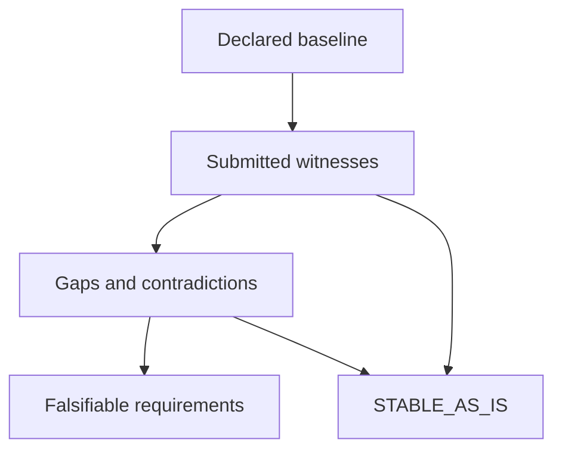

# Mission Assurance Delta Report

**STABLE_AS_IS** — SCOPED_WITNESSES_MATCH

Evaluation findings only. No security certification or implementation promotion is authorized.

| Baseline | Version | Environment | As of UTC | Contract SHA-256 |
| --- | --- | --- | --- | --- |
| hmt-mission-assurance | 0.1.0+source.fa456ec41767d5fd | local-python-3-12-14 | 2026-10-18T21:24:32.583023+00:00 | b00e4a6838b2be11b8c8d6c2507b592eaa5ad8e0b4c78aa057d94b540450bbc8 |

## Scope and evidence basis

Consistency of selected actual local pytest execution records and implementation obligations.

Consistency of caller-supplied execution records against a caller-declared contract. Hashes verify content integrity, not producer identity, execution authenticity, or truth.

- Local Python 3.12.14; hosted CI is a separate witness.
- Producer assertions are locally generated and not independently authenticated.
- No whole-project security, causal improvement, or generalization claim.
- No independent execution or producer authentication is performed.
- No inference of completeness outside declared claims, scenarios, and couplings.
- A matching witness establishes neither causal attribution nor generalization.

| Declared scenarios | Exercised | Satisfied | Undeclared mode obligations |
| --- | --- | --- | --- |
| 9 | 9 | 9 | 0 |

Counts cover the declared scenario set. They are not whole-project coverage or confidence scores.

## Baseline claims

| Claim | Statement | Implementation references |
| --- | --- | --- |
| C-CONTRACT | Typed input and evidence checks in selected cases | src/hmt\_mission\_assurance/contract.py |
| C-READONLY | Read-only MCP and repeatable evaluation in selected cases | src/hmt\_mission\_assurance/server.py |
| C-REPORT | Faithful graph and inert untrusted text in selected cases | src/hmt\_mission\_assurance/reports.py |

## Findings and hypotheses

| Finding | Disposition | Expected | Observed | Evidence | Hypothesis | Release condition |
| --- | --- | --- | --- | --- | --- | --- |

## Falsifiable requirements and proposed changes

| Requirement | Gap | Kind | Baseline evidence | Acceptance threshold | Regression witness | Proposed change |
| --- | --- | --- | --- | --- | --- | --- |

If improvement is not demonstrated: preserve the baseline and do not promote.

## Traceability matrix

| Claim | Scenario | Mode | Acceptance | Evidence | Findings | Requirements |
| --- | --- | --- | --- | --- | --- | --- |
| C-CONTRACT | S-CONTRACT-negative | negative | passed | EV-S-CONTRACT-negative | scoped match | none |
| C-CONTRACT | S-CONTRACT-positive | positive | passed | EV-S-CONTRACT-positive | scoped match | none |
| C-CONTRACT | S-CONTRACT-regression | regression | passed | EV-S-CONTRACT-regression | scoped match | none |
| C-READONLY | S-READONLY-negative | negative | passed | EV-S-READONLY-negative | scoped match | none |
| C-READONLY | S-READONLY-positive | positive | passed | EV-S-READONLY-positive | scoped match | none |
| C-READONLY | S-READONLY-regression | regression | passed | EV-S-READONLY-regression | scoped match | none |
| C-REPORT | S-REPORT-negative | negative | passed | EV-S-REPORT-negative | scoped match | none |
| C-REPORT | S-REPORT-positive | positive | passed | EV-S-REPORT-positive | scoped match | none |
| C-REPORT | S-REPORT-regression | regression | passed | EV-S-REPORT-regression | scoped match | none |

## Declared couplings

| Coupling | Source | Target | Witness scenario | Meaning |
| --- | --- | --- | --- | --- |
| K-REPORT-INPUT | C-CONTRACT | C-REPORT | S-REPORT-negative | Untrusted contract strings remain inert in rendered reports. |

## Evidence accountability

| Evidence | Source | Producer context | Captured UTC | SHA-256 | Check |
| --- | --- | --- | --- | --- | --- |
| EV-S-CONTRACT-positive | evidence/junit.xml:test\_scoped\_stability | hmt-mission-assurance/0.1.0+source.fa456ec41767d5fd/local-python-3-12-14 | 2026-10-18T21:24:17.931519+00:00 | 3d86c01cdf89255e3eb9dd8e4f81ce8ac08908611e1e412d450f454f9eaf9c20 | USABLE\_SUBMITTED\_WITNESS |
| EV-S-CONTRACT-negative | evidence/junit.xml:test\_dangling\_evidence | hmt-mission-assurance/0.1.0+source.fa456ec41767d5fd/local-python-3-12-14 | 2026-10-18T21:24:17.931519+00:00 | 43bde0537aa71b677c3b2dfd8510c70285a239fd2338817fa105827f725083eb | USABLE\_SUBMITTED\_WITNESS |
| EV-S-CONTRACT-regression | evidence/junit.xml:test\_requirement\_identity\_and\_evidence\_binding | hmt-mission-assurance/0.1.0+source.fa456ec41767d5fd/local-python-3-12-14 | 2026-10-18T21:24:17.931519+00:00 | 714d4ebb53326b0938fd67d8e9ae781de689987f6ae75886912a2c1e14c27974 | USABLE\_SUBMITTED\_WITNESS |
| EV-S-READONLY-positive | evidence/junit.xml:test\_stdio\_protocol | hmt-mission-assurance/0.1.0+source.fa456ec41767d5fd/local-python-3-12-14 | 2026-10-18T21:24:17.931519+00:00 | 6d1c525040f5e1e54356a1439ef3ab54ed71a99b3189322cd78c22e0354d78c4 | USABLE\_SUBMITTED\_WITNESS |
| EV-S-READONLY-negative | evidence/junit.xml:test\_source\_reference\_never\_fetches | hmt-mission-assurance/0.1.0+source.fa456ec41767d5fd/local-python-3-12-14 | 2026-10-18T21:24:17.931519+00:00 | 5cd5c19ab25d330c76ca24f5b78527b5ef8d9404986baeaebcc61cfe197fc24d | USABLE\_SUBMITTED\_WITNESS |
| EV-S-READONLY-regression | evidence/junit.xml:test\_replay\_and\_cross\_call\_isolation | hmt-mission-assurance/0.1.0+source.fa456ec41767d5fd/local-python-3-12-14 | 2026-10-18T21:24:17.931519+00:00 | 76c343b7040cb93a651f91a3104da3f5c5e0ac5a928f57013bf6b67a2b12c744 | USABLE\_SUBMITTED\_WITNESS |
| EV-S-REPORT-positive | evidence/junit.xml:test\_graph\_fidelity\_and\_machine\_record | hmt-mission-assurance/0.1.0+source.fa456ec41767d5fd/local-python-3-12-14 | 2026-10-18T21:24:17.931519+00:00 | b7ccdf7e5e0c6b943e28709cad4bba82f5aed61449782c20b926bc3c6223ee83 | USABLE\_SUBMITTED\_WITNESS |
| EV-S-REPORT-negative | evidence/junit.xml:test\_html\_and\_markdown\_injection | hmt-mission-assurance/0.1.0+source.fa456ec41767d5fd/local-python-3-12-14 | 2026-10-18T21:24:17.931519+00:00 | 5ff8a8e64d830b6550e80f14a4b61e23010e128144d8cad1b618b687d9aad7ea | USABLE\_SUBMITTED\_WITNESS |
| EV-S-REPORT-regression | evidence/junit.xml:test\_full\_findings\_and\_requirements\_visible | hmt-mission-assurance/0.1.0+source.fa456ec41767d5fd/local-python-3-12-14 | 2026-10-18T21:24:17.931519+00:00 | e8ddc17a1626dec732034e31099990d0f147c4a3deec66b065bd4f0553ca1b06 | USABLE\_SUBMITTED\_WITNESS |

## Decision flow



The complete graph, including every declared coupling, is in the structured record and offline HTML.

## Machine-readable evaluation and graph

```json
{"admission_authorized":false,"as_of":"2026-10-18T21:24:32.583023+00:00","baseline_version":"0.1.0+source.fa456ec41767d5fd","contract_sha256":"b00e4a6838b2be11b8c8d6c2507b592eaa5ad8e0b4c78aa057d94b540450bbc8","coverage":{"basis":"declared_scenarios_only","declared_scenarios":9,"exercised_scenarios":9,"missing_mode_obligations":0,"satisfied_scenarios":9},"delta_required":false,"evaluator_version":"0.1.0","evidence_basis":"Consistency of caller-supplied execution records against a caller-declared contract. Hashes verify content integrity, not producer identity, execution authenticity, or truth.","evidence_checks":[{"actual":"passed","evidence_id":"EV-S-CONTRACT-negative","reason_code":"USABLE_SUBMITTED_WITNESS","scenario_id":"S-CONTRACT-negative","usable":true},{"actual":"passed","evidence_id":"EV-S-CONTRACT-positive","reason_code":"USABLE_SUBMITTED_WITNESS","scenario_id":"S-CONTRACT-positive","usable":true},{"actual":"passed","evidence_id":"EV-S-CONTRACT-regression","reason_code":"USABLE_SUBMITTED_WITNESS","scenario_id":"S-CONTRACT-regression","usable":true},{"actual":"passed","evidence_id":"EV-S-READONLY-negative","reason_code":"USABLE_SUBMITTED_WITNESS","scenario_id":"S-READONLY-negative","usable":true},{"actual":"passed","evidence_id":"EV-S-READONLY-positive","reason_code":"USABLE_SUBMITTED_WITNESS","scenario_id":"S-READONLY-positive","usable":true},{"actual":"passed","evidence_id":"EV-S-READONLY-regression","reason_code":"USABLE_SUBMITTED_WITNESS","scenario_id":"S-READONLY-regression","usable":true},{"actual":"passed","evidence_id":"EV-S-REPORT-negative","reason_code":"USABLE_SUBMITTED_WITNESS","scenario_id":"S-REPORT-negative","usable":true},{"actual":"passed","evidence_id":"EV-S-REPORT-positive","reason_code":"USABLE_SUBMITTED_WITNESS","scenario_id":"S-REPORT-positive","usable":true},{"actual":"passed","evidence_id":"EV-S-REPORT-regression","reason_code":"USABLE_SUBMITTED_WITNESS","scenario_id":"S-REPORT-regression","usable":true}],"findings":[],"graph":{"edges":[{"relation":"depends","source":"claim:C-CONTRACT","target":"coupling:K-REPORT-INPUT"},{"relation":"scoped_match","source":"claim:C-CONTRACT","target":"disposition:primary"},{"relation":"negative","source":"claim:C-CONTRACT","target":"scenario:S-CONTRACT-negative"},{"relation":"positive","source":"claim:C-CONTRACT","target":"scenario:S-CONTRACT-positive"},{"relation":"regression","source":"claim:C-CONTRACT","target":"scenario:S-CONTRACT-regression"},{"relation":"scoped_match","source":"claim:C-READONLY","target":"disposition:primary"},{"relation":"negative","source":"claim:C-READONLY","target":"scenario:S-READONLY-negative"},{"relation":"positive","source":"claim:C-READONLY","target":"scenario:S-READONLY-positive"},{"relation":"regression","source":"claim:C-READONLY","target":"scenario:S-READONLY-regression"},{"relation":"scoped_match","source":"claim:C-REPORT","target":"disposition:primary"},{"relation":"negative","source":"claim:C-REPORT","target":"scenario:S-REPORT-negative"},{"relation":"positive","source":"claim:C-REPORT","target":"scenario:S-REPORT-positive"},{"relation":"regression","source":"claim:C-REPORT","target":"scenario:S-REPORT-regression"},{"relation":"receives","source":"coupling:K-REPORT-INPUT","target":"claim:C-REPORT"},{"relation":"witness","source":"coupling:K-REPORT-INPUT","target":"scenario:S-REPORT-negative"},{"relation":"submitted","source":"scenario:S-CONTRACT-negative","target":"evidence:EV-S-CONTRACT-negative"},{"relation":"submitted","source":"scenario:S-CONTRACT-positive","target":"evidence:EV-S-CONTRACT-positive"},{"relation":"submitted","source":"scenario:S-CONTRACT-regression","target":"evidence:EV-S-CONTRACT-regression"},{"relation":"submitted","source":"scenario:S-READONLY-negative","target":"evidence:EV-S-READONLY-negative"},{"relation":"submitted","source":"scenario:S-READONLY-positive","target":"evidence:EV-S-READONLY-positive"},{"relation":"submitted","source":"scenario:S-READONLY-regression","target":"evidence:EV-S-READONLY-regression"},{"relation":"submitted","source":"scenario:S-REPORT-negative","target":"evidence:EV-S-REPORT-negative"},{"relation":"submitted","source":"scenario:S-REPORT-positive","target":"evidence:EV-S-REPORT-positive"},{"relation":"submitted","source":"scenario:S-REPORT-regression","target":"evidence:EV-S-REPORT-regression"}],"nodes":[{"id":"claim:C-CONTRACT","kind":"claim","label":"Typed input and evidence checks in selected cases"},{"id":"claim:C-READONLY","kind":"claim","label":"Read-only MCP and repeatable evaluation in selected cases"},{"id":"claim:C-REPORT","kind":"claim","label":"Faithful graph and inert untrusted text in selected cases"},{"id":"coupling:K-REPORT-INPUT","kind":"coupling","label":"Untrusted contract strings remain inert in rendered reports."},{"id":"disposition:primary","kind":"disposition","label":"STABLE_AS_IS"},{"id":"evidence:EV-S-CONTRACT-negative","kind":"evidence","label":"evidence/junit.xml:test_dangling_evidence"},{"id":"evidence:EV-S-CONTRACT-positive","kind":"evidence","label":"evidence/junit.xml:test_scoped_stability"},{"id":"evidence:EV-S-CONTRACT-regression","kind":"evidence","label":"evidence/junit.xml:test_requirement_identity_and_evidence_binding"},{"id":"evidence:EV-S-READONLY-negative","kind":"evidence","label":"evidence/junit.xml:test_source_reference_never_fetches"},{"id":"evidence:EV-S-READONLY-positive","kind":"evidence","label":"evidence/junit.xml:test_stdio_protocol"},{"id":"evidence:EV-S-READONLY-regression","kind":"evidence","label":"evidence/junit.xml:test_replay_and_cross_call_isolation"},{"id":"evidence:EV-S-REPORT-negative","kind":"evidence","label":"evidence/junit.xml:test_html_and_markdown_injection"},{"id":"evidence:EV-S-REPORT-positive","kind":"evidence","label":"evidence/junit.xml:test_graph_fidelity_and_machine_record"},{"id":"evidence:EV-S-REPORT-regression","kind":"evidence","label":"evidence/junit.xml:test_full_findings_and_requirements_visible"},{"id":"scenario:S-CONTRACT-negative","kind":"scenario","label":"test_dangling_evidence"},{"id":"scenario:S-CONTRACT-positive","kind":"scenario","label":"test_scoped_stability"},{"id":"scenario:S-CONTRACT-regression","kind":"scenario","label":"test_requirement_identity_and_evidence_binding"},{"id":"scenario:S-READONLY-negative","kind":"scenario","label":"test_source_reference_never_fetches"},{"id":"scenario:S-READONLY-positive","kind":"scenario","label":"test_stdio_protocol"},{"id":"scenario:S-READONLY-regression","kind":"scenario","label":"test_replay_and_cross_call_isolation"},{"id":"scenario:S-REPORT-negative","kind":"scenario","label":"test_html_and_markdown_injection"},{"id":"scenario:S-REPORT-positive","kind":"scenario","label":"test_graph_fidelity_and_machine_record"},{"id":"scenario:S-REPORT-regression","kind":"scenario","label":"test_full_findings_and_requirements_visible"}]},"limitations":["Local Python 3.12.14; hosted CI is a separate witness.","Producer assertions are locally generated and not independently authenticated.","No whole-project security, causal improvement, or generalization claim.","No independent execution or producer authentication is performed.","No inference of completeness outside declared claims, scenarios, and couplings.","A matching witness establishes neither causal attribution nor generalization."],"primary_disposition":"STABLE_AS_IS","reason_code":"SCOPED_WITNESSES_MATCH","requirements":[],"scope":"Consistency of selected actual local pytest execution records and implementation obligations.","security_certification":false,"tool_id":"hmt-mission-assurance"}
```

