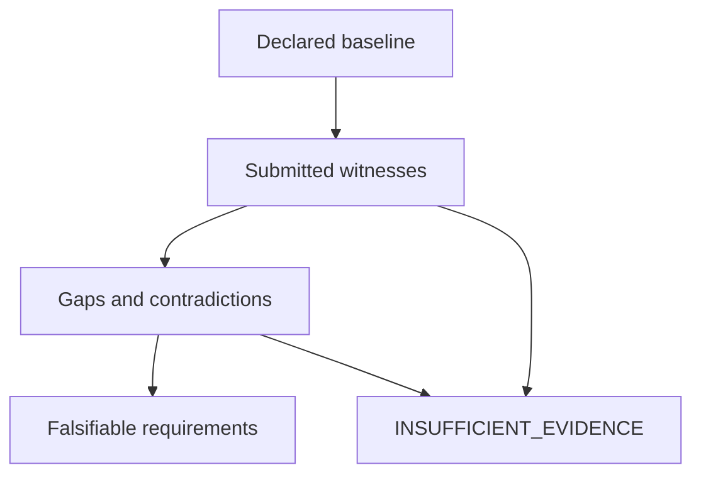

# Mission Assurance Delta Report

**INSUFFICIENT_EVIDENCE** — MISSING_EXECUTION_WITNESS

Evaluation findings only. No security certification or implementation promotion is authorized.

| Baseline | Version | Environment | As of UTC | Contract SHA-256 |
| --- | --- | --- | --- | --- |
| example-gateway | demo-v1 | synthetic-demo | 2026-10-18T20:00:00Z | 0c6252308e76ba9cd67a3a303ae15cdd2d4de45a8faa795f9b86add00f391d49 |

## Scope and evidence basis

Synthetic example: token acceptance/rejection and preservation of valid behavior.

Consistency of caller-supplied execution records against a caller-declared contract. Hashes verify content integrity, not producer identity, execution authenticity, or truth.

- Illustrative synthetic records; no gateway was executed.
- No general security claim.
- No independent execution or producer authentication is performed.
- No inference of completeness outside declared claims, scenarios, and couplings.
- A matching witness establishes neither causal attribution nor generalization.

| Declared scenarios | Exercised | Satisfied | Undeclared mode obligations |
| --- | --- | --- | --- |
| 3 | 1 | 1 | 0 |

Counts cover the declared scenario set. They are not whole-project coverage or confidence scores.

## Baseline claims

| Claim | Statement | Implementation references |
| --- | --- | --- |
| C-TOKEN | Valid tokens pass; invalid tokens are denied in these cases. | illustrative/gateway.py:authorize |

## Findings and hypotheses

| Finding | Disposition | Expected | Observed | Evidence | Hypothesis | Release condition |
| --- | --- | --- | --- | --- | --- | --- |
| F-4333d56f0ba0482d082f | INSUFFICIENT\_EVIDENCE | denied | No usable submitted execution witness | MISSING | Unconfirmed: the implementation or evidence collection may omit this obligation. | Supply current, consistent execution witnesses satisfying: denied |
| F-c8a578156d16b75d850d | INSUFFICIENT\_EVIDENCE | allowed | No usable submitted execution witness | MISSING | Unconfirmed: the implementation or evidence collection may omit this obligation. | Supply current, consistent execution witnesses satisfying: allowed |

## Falsifiable requirements and proposed changes

| Requirement | Gap | Kind | Baseline evidence | Acceptance threshold | Regression witness | Proposed change |
| --- | --- | --- | --- | --- | --- | --- |
| REQ-4333d56f0ba0482d082f | F-4333d56f0ba0482d082f | collect\_evidence | 0c6252308e76ba9cd67a3a303ae15cdd2d4de45a8faa795f9b86add00f391d49 | Supply current, consistent execution witnesses satisfying: denied | S-REGRESS | Collect the missing scoped evidence; do not infer a runtime defect. |
| REQ-c8a578156d16b75d850d | F-c8a578156d16b75d850d | collect\_evidence | 0c6252308e76ba9cd67a3a303ae15cdd2d4de45a8faa795f9b86add00f391d49 | Supply current, consistent execution witnesses satisfying: allowed | S-REGRESS | Collect the missing scoped evidence; do not infer a runtime defect. |

If improvement is not demonstrated: preserve the baseline and do not promote.

## Traceability matrix

| Claim | Scenario | Mode | Acceptance | Evidence | Findings | Requirements |
| --- | --- | --- | --- | --- | --- | --- |
| C-TOKEN | S-INVALID | negative | denied | MISSING | F-4333d56f0ba0482d082f | REQ-4333d56f0ba0482d082f |
| C-TOKEN | S-REGRESS | regression | allowed | MISSING | F-c8a578156d16b75d850d | REQ-c8a578156d16b75d850d |
| C-TOKEN | S-VALID | positive | allowed | EV-0 | scoped match | none |

## Declared couplings

| Coupling | Source | Target | Witness scenario | Meaning |
| --- | --- | --- | --- | --- |

## Evidence accountability

| Evidence | Source | Producer context | Captured UTC | SHA-256 | Check |
| --- | --- | --- | --- | --- | --- |
| EV-0 | synthetic-demo:S-VALID | example-gateway/demo-v1/synthetic-demo | 2026-10-18T19:59:00Z | 90a33e16e07affce7f49de90c2bf41cd31f553ac9462450c8f4dd56310db4133 | USABLE\_SUBMITTED\_WITNESS |

## Decision flow



The complete graph, including every declared coupling, is in the structured record and offline HTML.

## Machine-readable evaluation and graph

```json
{"admission_authorized":false,"as_of":"2026-10-18T20:00:00Z","baseline_version":"demo-v1","contract_sha256":"0c6252308e76ba9cd67a3a303ae15cdd2d4de45a8faa795f9b86add00f391d49","coverage":{"basis":"declared_scenarios_only","declared_scenarios":3,"exercised_scenarios":1,"missing_mode_obligations":0,"satisfied_scenarios":1},"delta_required":false,"evaluator_version":"0.1.0","evidence_basis":"Consistency of caller-supplied execution records against a caller-declared contract. Hashes verify content integrity, not producer identity, execution authenticity, or truth.","evidence_checks":[{"actual":"allowed","evidence_id":"EV-0","reason_code":"USABLE_SUBMITTED_WITNESS","scenario_id":"S-VALID","usable":true}],"findings":[{"claim_id":"C-TOKEN","disposition":"INSUFFICIENT_EVIDENCE","evidence_refs":[],"expected":"denied","hypothesis":"Unconfirmed: the implementation or evidence collection may omit this obligation.","id":"F-4333d56f0ba0482d082f","observed":"No usable submitted execution witness","reason_code":"MISSING_EXECUTION_WITNESS","release_condition":"Supply current, consistent execution witnesses satisfying: denied","scenario_id":"S-INVALID"},{"claim_id":"C-TOKEN","disposition":"INSUFFICIENT_EVIDENCE","evidence_refs":[],"expected":"allowed","hypothesis":"Unconfirmed: the implementation or evidence collection may omit this obligation.","id":"F-c8a578156d16b75d850d","observed":"No usable submitted execution witness","reason_code":"MISSING_EXECUTION_WITNESS","release_condition":"Supply current, consistent execution witnesses satisfying: allowed","scenario_id":"S-REGRESS"}],"graph":{"edges":[{"relation":"negative","source":"claim:C-TOKEN","target":"scenario:S-INVALID"},{"relation":"regression","source":"claim:C-TOKEN","target":"scenario:S-REGRESS"},{"relation":"positive","source":"claim:C-TOKEN","target":"scenario:S-VALID"},{"relation":"INSUFFICIENT_EVIDENCE","source":"finding:F-4333d56f0ba0482d082f","target":"disposition:primary"},{"relation":"derive","source":"finding:F-4333d56f0ba0482d082f","target":"requirement:REQ-4333d56f0ba0482d082f"},{"relation":"INSUFFICIENT_EVIDENCE","source":"finding:F-c8a578156d16b75d850d","target":"disposition:primary"},{"relation":"derive","source":"finding:F-c8a578156d16b75d850d","target":"requirement:REQ-c8a578156d16b75d850d"},{"relation":"finding","source":"scenario:S-INVALID","target":"finding:F-4333d56f0ba0482d082f"},{"relation":"finding","source":"scenario:S-REGRESS","target":"finding:F-c8a578156d16b75d850d"},{"relation":"submitted","source":"scenario:S-VALID","target":"evidence:EV-0"}],"nodes":[{"id":"claim:C-TOKEN","kind":"claim","label":"Valid tokens pass; invalid tokens are denied in these cases."},{"id":"disposition:primary","kind":"disposition","label":"INSUFFICIENT_EVIDENCE"},{"id":"evidence:EV-0","kind":"evidence","label":"synthetic-demo:S-VALID"},{"id":"finding:F-4333d56f0ba0482d082f","kind":"finding","label":"MISSING_EXECUTION_WITNESS"},{"id":"finding:F-c8a578156d16b75d850d","kind":"finding","label":"MISSING_EXECUTION_WITNESS"},{"id":"requirement:REQ-4333d56f0ba0482d082f","kind":"requirement","label":"Supply current, consistent execution witnesses satisfying: denied"},{"id":"requirement:REQ-c8a578156d16b75d850d","kind":"requirement","label":"Supply current, consistent execution witnesses satisfying: allowed"},{"id":"scenario:S-INVALID","kind":"scenario","label":"Invalid token"},{"id":"scenario:S-REGRESS","kind":"scenario","label":"Previously valid token still passes"},{"id":"scenario:S-VALID","kind":"scenario","label":"Valid token"}]},"limitations":["Illustrative synthetic records; no gateway was executed.","No general security claim.","No independent execution or producer authentication is performed.","No inference of completeness outside declared claims, scenarios, and couplings.","A matching witness establishes neither causal attribution nor generalization."],"primary_disposition":"INSUFFICIENT_EVIDENCE","reason_code":"MISSING_EXECUTION_WITNESS","requirements":[{"acceptance_threshold":"Supply current, consistent execution witnesses satisfying: denied","baseline_contract_ref":"0c6252308e76ba9cd67a3a303ae15cdd2d4de45a8faa795f9b86add00f391d49","baseline_evidence_refs":[],"finding_id":"F-4333d56f0ba0482d082f","id":"REQ-4333d56f0ba0482d082f","if_not_demonstrated":"preserve_baseline_and_do_not_promote","kind":"collect_evidence","proposed_change":"Collect the missing scoped evidence; do not infer a runtime defect.","regression_witness":["S-REGRESS"]},{"acceptance_threshold":"Supply current, consistent execution witnesses satisfying: allowed","baseline_contract_ref":"0c6252308e76ba9cd67a3a303ae15cdd2d4de45a8faa795f9b86add00f391d49","baseline_evidence_refs":[],"finding_id":"F-c8a578156d16b75d850d","id":"REQ-c8a578156d16b75d850d","if_not_demonstrated":"preserve_baseline_and_do_not_promote","kind":"collect_evidence","proposed_change":"Collect the missing scoped evidence; do not infer a runtime defect.","regression_witness":["S-REGRESS"]}],"scope":"Synthetic example: token acceptance/rejection and preservation of valid behavior.","security_certification":false,"tool_id":"example-gateway"}
```
