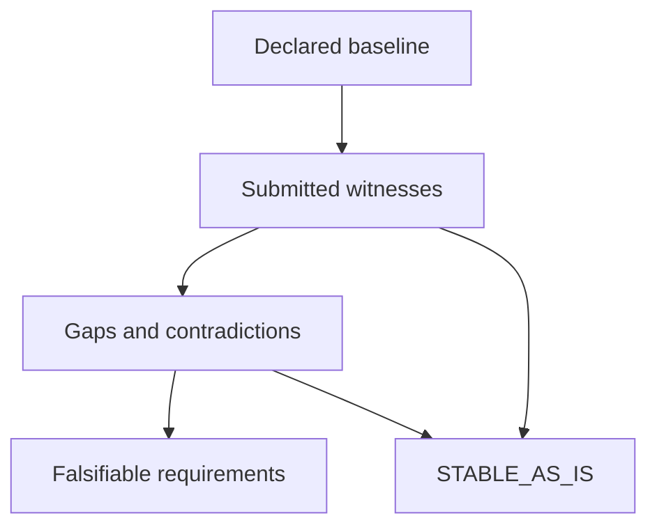

# Mission Assurance Delta Report

**STABLE_AS_IS** — SCOPED_WITNESSES_MATCH

Evaluation findings only. No security certification or implementation promotion is authorized.

| Baseline | Version | Environment | As of UTC | Contract SHA-256 |
| --- | --- | --- | --- | --- |
| example-gateway | demo-v2 | synthetic-demo | 2026-10-18T20:00:00Z | 71dff9e67be04c5cff030834b9a17aebfbe784f5e10672f0065db7e275b326a6 |

## Scope and evidence basis

Synthetic example: token acceptance/rejection and preservation of valid behavior.

Consistency of caller-supplied execution records against a caller-declared contract. Hashes verify content integrity, not producer identity, execution authenticity, or truth.

- Illustrative synthetic records; no gateway was executed.
- No general security claim.
- No independent execution or producer authentication is performed.
- No inference of completeness outside declared claims, scenarios, and couplings.
- A matching witness establishes neither causal attribution nor generalization.

| Declared scenarios | Exercised | Satisfied | Undeclared mode obligations |
| --- | --- | --- | --- |
| 6 | 6 | 6 | 0 |

Counts cover the declared scenario set. They are not whole-project coverage or confidence scores.

## Baseline claims

| Claim | Statement | Implementation references |
| --- | --- | --- |
| C-TOKEN | Valid tokens pass; invalid tokens are denied in these cases. | illustrative/gateway.py:authorize |
| C-AUDIT | Authorization outcomes retain audit records in these cases. | illustrative/gateway.py:authorize |

## Findings and hypotheses

| Finding | Disposition | Expected | Observed | Evidence | Hypothesis | Release condition |
| --- | --- | --- | --- | --- | --- | --- |

## Falsifiable requirements and proposed changes

| Requirement | Gap | Kind | Baseline evidence | Acceptance threshold | Regression witness | Proposed change |
| --- | --- | --- | --- | --- | --- | --- |

If improvement is not demonstrated: preserve the baseline and do not promote.

## Traceability matrix

| Claim | Scenario | Mode | Acceptance | Evidence | Findings | Requirements |
| --- | --- | --- | --- | --- | --- | --- |
| C-AUDIT | A-S-INVALID | negative | recorded | EV-4 | scoped match | none |
| C-AUDIT | A-S-REGRESS | regression | recorded | EV-5 | scoped match | none |
| C-AUDIT | A-S-VALID | positive | recorded | EV-3 | scoped match | none |
| C-TOKEN | S-INVALID | negative | denied | EV-1 | scoped match | none |
| C-TOKEN | S-REGRESS | regression | allowed | EV-2 | scoped match | none |
| C-TOKEN | S-VALID | positive | allowed | EV-0 | scoped match | none |

## Declared couplings

| Coupling | Source | Target | Witness scenario | Meaning |
| --- | --- | --- | --- | --- |
| K-AUDIT | C-TOKEN | C-AUDIT | A-S-INVALID | Denied token outcomes reach the audit seam. |

## Evidence accountability

| Evidence | Source | Producer context | Captured UTC | SHA-256 | Check |
| --- | --- | --- | --- | --- | --- |
| EV-0 | synthetic-demo:S-VALID | example-gateway/demo-v2/synthetic-demo | 2026-10-18T19:59:00Z | 90a33e16e07affce7f49de90c2bf41cd31f553ac9462450c8f4dd56310db4133 | USABLE\_SUBMITTED\_WITNESS |
| EV-1 | synthetic-demo:S-INVALID | example-gateway/demo-v2/synthetic-demo | 2026-10-18T19:59:00Z | 3f6a6ee80daea8e5ead410c75cf3456b6c18c8780aa8827c6a21c46c099f9e89 | USABLE\_SUBMITTED\_WITNESS |
| EV-2 | synthetic-demo:S-REGRESS | example-gateway/demo-v2/synthetic-demo | 2026-10-18T19:59:00Z | 111ec6d54ecd57644741e65edd2ffe9be14e2e47007718298ba35930693cf864 | USABLE\_SUBMITTED\_WITNESS |
| EV-3 | synthetic-demo:A-S-VALID | example-gateway/demo-v2/synthetic-demo | 2026-10-18T19:59:00Z | 48807f6b28a5fa65e630d0ac30b185bc1a233780dd183b3926545da6d6723ff1 | USABLE\_SUBMITTED\_WITNESS |
| EV-4 | synthetic-demo:A-S-INVALID | example-gateway/demo-v2/synthetic-demo | 2026-10-18T19:59:00Z | 33b91895883cffcaa596e9297aad2c41b0d8a0562c990b1765324eec86247a0a | USABLE\_SUBMITTED\_WITNESS |
| EV-5 | synthetic-demo:A-S-REGRESS | example-gateway/demo-v2/synthetic-demo | 2026-10-18T19:59:00Z | 67a15bac552e330cff1359997055b69f2239757d5eaf96f5c1481b563f7ec1ac | USABLE\_SUBMITTED\_WITNESS |

## Decision flow



The complete graph, including every declared coupling, is in the structured record and offline HTML.

## Machine-readable evaluation and graph

```json
{"admission_authorized":false,"as_of":"2026-10-18T20:00:00Z","baseline_version":"demo-v2","contract_sha256":"71dff9e67be04c5cff030834b9a17aebfbe784f5e10672f0065db7e275b326a6","coverage":{"basis":"declared_scenarios_only","declared_scenarios":6,"exercised_scenarios":6,"missing_mode_obligations":0,"satisfied_scenarios":6},"delta_required":false,"evaluator_version":"0.1.0","evidence_basis":"Consistency of caller-supplied execution records against a caller-declared contract. Hashes verify content integrity, not producer identity, execution authenticity, or truth.","evidence_checks":[{"actual":"allowed","evidence_id":"EV-0","reason_code":"USABLE_SUBMITTED_WITNESS","scenario_id":"S-VALID","usable":true},{"actual":"denied","evidence_id":"EV-1","reason_code":"USABLE_SUBMITTED_WITNESS","scenario_id":"S-INVALID","usable":true},{"actual":"allowed","evidence_id":"EV-2","reason_code":"USABLE_SUBMITTED_WITNESS","scenario_id":"S-REGRESS","usable":true},{"actual":"recorded","evidence_id":"EV-3","reason_code":"USABLE_SUBMITTED_WITNESS","scenario_id":"A-S-VALID","usable":true},{"actual":"recorded","evidence_id":"EV-4","reason_code":"USABLE_SUBMITTED_WITNESS","scenario_id":"A-S-INVALID","usable":true},{"actual":"recorded","evidence_id":"EV-5","reason_code":"USABLE_SUBMITTED_WITNESS","scenario_id":"A-S-REGRESS","usable":true}],"findings":[],"graph":{"edges":[{"relation":"scoped_match","source":"claim:C-AUDIT","target":"disposition:primary"},{"relation":"negative","source":"claim:C-AUDIT","target":"scenario:A-S-INVALID"},{"relation":"regression","source":"claim:C-AUDIT","target":"scenario:A-S-REGRESS"},{"relation":"positive","source":"claim:C-AUDIT","target":"scenario:A-S-VALID"},{"relation":"depends","source":"claim:C-TOKEN","target":"coupling:K-AUDIT"},{"relation":"scoped_match","source":"claim:C-TOKEN","target":"disposition:primary"},{"relation":"negative","source":"claim:C-TOKEN","target":"scenario:S-INVALID"},{"relation":"regression","source":"claim:C-TOKEN","target":"scenario:S-REGRESS"},{"relation":"positive","source":"claim:C-TOKEN","target":"scenario:S-VALID"},{"relation":"receives","source":"coupling:K-AUDIT","target":"claim:C-AUDIT"},{"relation":"witness","source":"coupling:K-AUDIT","target":"scenario:A-S-INVALID"},{"relation":"submitted","source":"scenario:A-S-INVALID","target":"evidence:EV-4"},{"relation":"submitted","source":"scenario:A-S-REGRESS","target":"evidence:EV-5"},{"relation":"submitted","source":"scenario:A-S-VALID","target":"evidence:EV-3"},{"relation":"submitted","source":"scenario:S-INVALID","target":"evidence:EV-1"},{"relation":"submitted","source":"scenario:S-REGRESS","target":"evidence:EV-2"},{"relation":"submitted","source":"scenario:S-VALID","target":"evidence:EV-0"}],"nodes":[{"id":"claim:C-AUDIT","kind":"claim","label":"Authorization outcomes retain audit records in these cases."},{"id":"claim:C-TOKEN","kind":"claim","label":"Valid tokens pass; invalid tokens are denied in these cases."},{"id":"coupling:K-AUDIT","kind":"coupling","label":"Denied token outcomes reach the audit seam."},{"id":"disposition:primary","kind":"disposition","label":"STABLE_AS_IS"},{"id":"evidence:EV-0","kind":"evidence","label":"synthetic-demo:S-VALID"},{"id":"evidence:EV-1","kind":"evidence","label":"synthetic-demo:S-INVALID"},{"id":"evidence:EV-2","kind":"evidence","label":"synthetic-demo:S-REGRESS"},{"id":"evidence:EV-3","kind":"evidence","label":"synthetic-demo:A-S-VALID"},{"id":"evidence:EV-4","kind":"evidence","label":"synthetic-demo:A-S-INVALID"},{"id":"evidence:EV-5","kind":"evidence","label":"synthetic-demo:A-S-REGRESS"},{"id":"scenario:A-S-INVALID","kind":"scenario","label":"Invalid token"},{"id":"scenario:A-S-REGRESS","kind":"scenario","label":"Previously valid token still passes"},{"id":"scenario:A-S-VALID","kind":"scenario","label":"Valid token"},{"id":"scenario:S-INVALID","kind":"scenario","label":"Invalid token"},{"id":"scenario:S-REGRESS","kind":"scenario","label":"Previously valid token still passes"},{"id":"scenario:S-VALID","kind":"scenario","label":"Valid token"}]},"limitations":["Illustrative synthetic records; no gateway was executed.","No general security claim.","No independent execution or producer authentication is performed.","No inference of completeness outside declared claims, scenarios, and couplings.","A matching witness establishes neither causal attribution nor generalization."],"primary_disposition":"STABLE_AS_IS","reason_code":"SCOPED_WITNESSES_MATCH","requirements":[],"scope":"Synthetic example: token acceptance/rejection and preservation of valid behavior.","security_certification":false,"tool_id":"example-gateway"}
```
